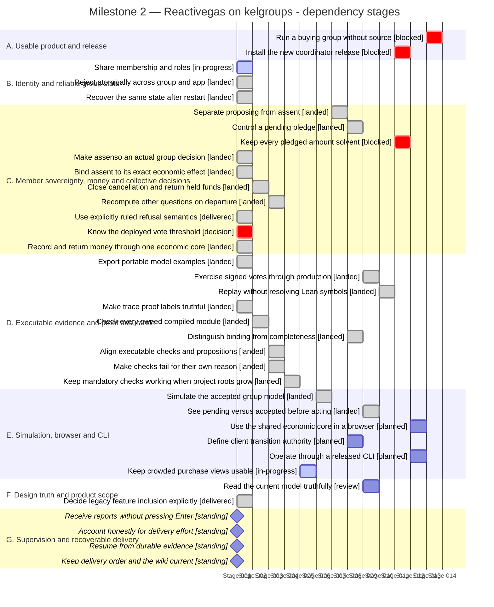

# Milestone 2 — Reactivegas on kelgroups

Last reconciled: **2026-11-10T23:30:00Z**. Team: **RUNNING**. [Milestone](https://github.com/paolino/reactivegas/milestone/2).

Resumed 2026-11-08. Landed since: CI runner fix (PR100), #76 (PR93), #81 L-7 (PR102), #66 Lean quality complete (S3 PR98; S5 PR103, PR108, PR110, PR111, PR112, PR116; #66 closed), #70 simulator complete (PR104-PR107, PR109, PR115, PR117; #70 closed), #69 member pledge control (PR114, closed), #75 integrated vote corpus (PR113, closed). Master ddb1703. No lane running. Not staffed: #71 design record, #82-#84 clients, #67 Haskell remainder, #51 release, #73 substrate (kelgroups side). Hosted Lean mutant ledger at 93 of 120 minutes; the next ledger-growing slice likely crosses the 110-minute stop line.

> Stories describe outcomes; tickets are delivery containers. The mapping is many-to-many. Unticketed work, decisions and standing obligations are named explicitly. A landed enabler does not mean the product outcome is delivered.

## Delivery map

**Dependency-stage Gantt — not a calendar forecast.** Each equal-width bar occupies one dependency stage; positions are calculated from the prerequisites below. Synthetic dates are rendering coordinates only. Widths are not effort, duration or completion percentages. Standing obligations are checkpoints. Same-stage rows may be independent, but this chart grants no dispatch authority.

Labels report delivery state; only in-progress rows use active colouring.

State key: **landed/delivered** = evidence linked; **review/ready** = not landed; **blocked/decision** = unresolved prerequisite; **planned** = not commissioned; **standing** = continuing obligation.

## A. Usable product and release

| Story | Kind | Tracking | State | Owner |
|---|---|---|---|---|
| [Run a buying group without source](#s-01) | outcome | Ticketed — [Reactivegas #72](https://github.com/paolino/reactivegas/issues/72), [Reactivegas #43](https://github.com/paolino/reactivegas/issues/43), [Reactivegas #67](https://github.com/paolino/reactivegas/issues/67) | blocked | Milestone owner |
| [Install the new coordinator release](#s-27) | product | Ticketed — [Reactivegas #67](https://github.com/paolino/reactivegas/issues/67), [Reactivegas #51](https://github.com/paolino/reactivegas/issues/51) | blocked | Haskell delivery owner |

### Run a buying group without source

**As a new group organiser, I want to download and run the complete service, so that my group can elect, collect, pledge, assent, purchase and refund.**

**Tracking:** Ticketed. Milestone outcome across several epics and tickets. Historical epic #43 remains open for traceability and is not being respawned; #72 is the current delivery map. [Reactivegas #72](https://github.com/paolino/reactivegas/issues/72), [Reactivegas #43](https://github.com/paolino/reactivegas/issues/43), [Reactivegas #67](https://github.com/paolino/reactivegas/issues/67).

**Now — blocked:** The required stranger journey has not been demonstrated on the new Haskell coordinator. Released browser and CLI clients are also required. Legacy releases, proofs and simulator runs do not establish this outcome.

**Acceptance:** An independent person downloads the released coordinator, browser and CLI and exercises all six actions with meaningful state effects and required refusals, without a source build.

**Dependencies:** [Install the new coordinator release](#s-27); [Use the shared economic core in a browser](#s-24); [Operate through a released CLI](#s-26); [Read the current model truthfully](#s-28); [Decide legacy feature inclusion explicitly](#s-29)

**Next:** Follow the accepted dependency sequence; close the milestone only on the released user journey.

**Evidence:** No completion evidence claimed.

### Install the new coordinator release

**As an installing operator, I want the familiar archive entrypoint to run the new coordinator, so that installation is reproducible and the downloaded identity is verifiable.**

**Tracking:** Ticketed. #67 covers implementation and coordinator delivery; #51 retains separate release-identity obligations. A green release workflow alone is not product acceptance. [Reactivegas #67](https://github.com/paolino/reactivegas/issues/67), [Reactivegas #51](https://github.com/paolino/reactivegas/issues/51).

**Now — blocked:** The settled package is a Reactivegas-owned Cabal executable linking the kelgroups library and Reactivegas app at build time. Archive naming and bin/server stay, but their new bytes require new evidence. D2-D5 remain unfinished; legacy provisional release #49 is historical.

**Acceptance:** Bind the new archive to accepted source; independently fetch and run it, including the six-step coordinator journey and exact release identity.

**Dependencies:** [Reject atomically across group and app](#s-03); [Recover the same state after restart](#s-04); [Control a pending pledge](#s-06); [Make assenso an actual group decision](#s-08); [Close cancellation and return held funds](#s-10); [Replay without resolving Lean symbols](#s-16)

**Next:** Complete substrate integration, economic implementation and API, then repeat release verification on the actual new artifact.

**Evidence:** [Reactivegas #49](https://github.com/paolino/reactivegas/issues/49)

## B. Identity and reliable group state

| Story | Kind | Tracking | State | Owner |
|---|---|---|---|---|
| [Share membership and roles](#s-02) | product | Ticketed — [Reactivegas #62](https://github.com/paolino/reactivegas/issues/62), [Reactivegas #73](https://github.com/paolino/reactivegas/issues/73), [kelgroups #29](https://github.com/paolino/kelgroups/issues/29), [kelgroups #30](https://github.com/paolino/kelgroups/issues/30), [kelgroups #33](https://github.com/paolino/kelgroups/issues/33), [kelgroups #34](https://github.com/paolino/kelgroups/issues/34) | in-progress | Codex Sol Kelgroups epic owner |
| [Reject atomically across group and app](#s-03) | enabler | Ticketed — [kelgroups #28](https://github.com/paolino/kelgroups/issues/28), [kelgroups #29](https://github.com/paolino/kelgroups/issues/29), [Reactivegas #73](https://github.com/paolino/reactivegas/issues/73) | landed | Kelgroups ticket owner |
| [Recover the same state after restart](#s-04) | product | Ticketed — [kelgroups #28](https://github.com/paolino/kelgroups/issues/28), [Reactivegas #73](https://github.com/paolino/reactivegas/issues/73) | landed | Kelgroups ticket owner |

### Share membership and roles

**As a group member, I want one identity and membership state across the system, so that permissions do not disagree between the group engine and economics.**

**Tracking:** Ticketed. The model ticket is closed and #28 landed. The cross-repository story remains unfinished under #73 and kelgroups #29, including vote interface #30, runnable demonstration #33 and release/downstream notes #34. These are delivery containers, not extra completion claims. [Reactivegas #62](https://github.com/paolino/reactivegas/issues/62), [Reactivegas #73](https://github.com/paolino/reactivegas/issues/73), [kelgroups #29](https://github.com/paolino/kelgroups/issues/29), [kelgroups #30](https://github.com/paolino/kelgroups/issues/30), [kelgroups #33](https://github.com/paolino/kelgroups/issues/33), [kelgroups #34](https://github.com/paolino/kelgroups/issues/34).

**Now — in-progress:** Kelgroups #28 and S30-1 are landed. S30-2 candidate bdeba37a remains byte-identical and no product defect has been demonstrated. Evidence-only S30-2D has one sole Codex/Astra launch: execution 1/4 ran the complete gate and passed; executions 2-4 remain unspent. The same live auditor is provider-capacity stalled and is preserved without input, retry, model switch or replacement under the fresh Codex Sol epic %641 and ticket owner %642; the predecessor Opus panes are retired.

**Acceptance:** The accepted group engine and economic application consume the same membership/role view, with integrated permission and refusal witnesses.

**Dependencies:** No prerequisite story recorded; this is not dispatch authority.

**Next:** Held on the kelgroups side; not staffed from this milestone session.

**Evidence:** [Reactivegas #62](https://github.com/paolino/reactivegas/issues/62), [Landed kelgroups integrated API — PR32](https://github.com/paolino/kelgroups/pull/32), [Accepted S30-1 candidate — draft PR35](https://github.com/paolino/kelgroups/pull/35)

### Reject atomically across group and app

**As an application developer, I want invalid integrated events to be refused atomically, so that a refusal cannot leave a partially updated group.**

**Tracking:** Ticketed. Implementation slice of kelgroups #28. The broader substrate epic also includes #30; this candidate is not acceptance of the whole epic. [kelgroups #28](https://github.com/paolino/kelgroups/issues/28), [kelgroups #29](https://github.com/paolino/kelgroups/issues/29), [Reactivegas #73](https://github.com/paolino/reactivegas/issues/73).

**Now — landed:** PR32 merged as933e385 on accepted368b596. The landed tree is byte-identical to the full independently audited ab25cd1 candidate; GitHub signature verification succeeds. Candidate remote CI passed; post-merge CI passed. All six required rows and five reliances were assessed within the stated finite scope, and the desk verified the135-file audit inventory. Broader #29/#73 completion remains separate.

**Acceptance:** Exercise each integrated path and rejection; independently demonstrate that disabling the membership check, hook refusal or other guarded effect breaks its stated acceptance row.

**Dependencies:** No prerequisite story recorded; this is not dispatch authority.

**Next:** Kelgroups #28 is closed after scope acceptance. Preserve its landed guarantees while preparing #30 and the remaining #73 contract before downstream Haskell integration.

**Evidence:** [Landed kelgroups integrated API — PR32](https://github.com/paolino/kelgroups/pull/32)

### Recover the same state after restart

**As a group organiser, I want event replay to recover the accepted live state, so that restarting cannot change the interpretation of group history.**

**Tracking:** Ticketed. This story is a slice of the linked delivery work; the issue may cover other stories too. [kelgroups #28](https://github.com/paolino/kelgroups/issues/28), [Reactivegas #73](https://github.com/paolino/reactivegas/issues/73).

**Now — landed:** Fresh independent evidence on the final candidate demonstrates conservation and actual database close/reopen across 160 tested concurrent schedules; the deliberately broken version loses updates in the paired experiment. The shipped concurrency checker independently fails on that defect and passes on the candidate. This is finite local assurance; crash/interruption between SQL and memory commits and separate-handle concurrency remain outside the established result. This bounded result landed in PR32 with an identical audited tree. Post-merge CI passed; no broader crash-safety claim follows.

**Acceptance:** Reopen a persisted log and recover exactly the live state; reject changed founding inputs and detect a mutant that leaves live state stale.

**Dependencies:** No prerequisite story recorded; this is not dispatch authority.

**Next:** Preserve the landed replay/refusal guarantees and exercise them again at the later Haskell integration boundary.

**Evidence:** [Landed kelgroups integrated API — PR32](https://github.com/paolino/kelgroups/pull/32)

## C. Member sovereignty, money and collective decisions

| Story | Kind | Tracking | State | Owner |
|---|---|---|---|---|
| [Separate proposing from assent](#s-05) | product | Ticketed — [Reactivegas #68](https://github.com/paolino/reactivegas/issues/68) | landed | Proposer-assent ticket owner |
| [Control a pending pledge](#s-06) | product | Ticketed — [Reactivegas #69](https://github.com/paolino/reactivegas/issues/69) | landed | Milestone owner |
| [Keep every pledged amount solvent](#s-07) | product | Ticketed — [Reactivegas #67](https://github.com/paolino/reactivegas/issues/67), [Reactivegas #66](https://github.com/paolino/reactivegas/issues/66) | blocked | Haskell delivery owner |
| [Make assenso an actual group decision](#s-08) | product | Ticketed — [Reactivegas #76](https://github.com/paolino/reactivegas/issues/76) | landed | Milestone owner until commissioning |
| [Bind assent to its exact economic effect](#s-09) | product | Ticketed — [Reactivegas #76](https://github.com/paolino/reactivegas/issues/76) | landed | Future composition ticket owner |
| [Close cancellation and return held funds](#s-10) | product | Ticketed — [Reactivegas #81](https://github.com/paolino/reactivegas/issues/81), [Reactivegas #76](https://github.com/paolino/reactivegas/issues/76) | landed | Milestone owner until commissioning |
| [Recompute other questions on departure](#s-11) | product | Ticketed — [Reactivegas #81](https://github.com/paolino/reactivegas/issues/81) | landed | Future lifecycle ticket owner |
| [Use explicitly ruled refusal semantics](#s-12) | product | Decision — [Reactivegas #81](https://github.com/paolino/reactivegas/issues/81), [Reactivegas #76](https://github.com/paolino/reactivegas/issues/76) | delivered | Operator |
| [Know the deployed vote threshold](#s-13) | product | Decision — [Reactivegas #75](https://github.com/paolino/reactivegas/issues/75), [Reactivegas #67](https://github.com/paolino/reactivegas/issues/67) | decision | Operator |
| [Record and return money through one economic core](#s-35) | product | Ticketed — [Reactivegas #90](https://github.com/paolino/reactivegas/issues/90), [Reactivegas #67](https://github.com/paolino/reactivegas/issues/67) | landed | Haskell delivery owner |

### Separate proposing from assent

**As a group administrator, I want opening and approving a proposal to be distinct, so that opening a question does not silently contribute assent.**

**Tracking:** Ticketed. This story is a slice of the linked delivery work; the issue may cover other stories too. [Reactivegas #68](https://github.com/paolino/reactivegas/issues/68).

**Now — landed:** Proposer signature no longer counts as assent (#68 A-001 ruling), landed through PR80.

**Acceptance:** Land the exact accepted candidate and demonstrate the ruled multi-admin and sole-admin behaviours in integrated reachable examples.

**Dependencies:** [Simulate the accepted group model](#s-22)

**Next:** Preserve; #69 builds on this base.

**Evidence:** [PR80 merged 2026-10-02 as f0ef076](https://github.com/paolino/reactivegas/pull/80)

### Control a pending pledge

**As a contributing member, I want to create, correct or retract my own pending pledge, so that my money remains under the ruled authority while it is pending.**

**Tracking:** Ticketed. #69 is the current delivery ticket. Historical #48 work is superseded; its closure does not fulfil this remaining story. [Reactivegas #69](https://github.com/paolino/reactivegas/issues/69).

**Now — landed:** Intake is prepared; implementation has not been commissioned. Zero must refund escrow and remove the pending entry. Accepted pledges have a different referente authority boundary. Closed historical #48 is not authority to revive its retired departure design.

**Acceptance:** Prove and exercise own-pledge changes, zero/refund/removal, and the post-acceptance boundary with current traces and independent audit.

**Dependencies:** [Separate proposing from assent](#s-05)

**Next:** Landed in the model and the simulator core. Carry into the Haskell coordinator (#67) and the integrated corpus (#75).

**Evidence:** [PR114 merged 2026-11-10 (self-service pledge while pending; referente-only after acceptance)](https://github.com/paolino/reactivegas/pull/114)

### Keep every pledged amount solvent

**As a contributor, I want escrow and spending to be accounted for consistently, so that funds cannot be spent twice or beyond available balances.**

**Tracking:** Ticketed. This story is a slice of the linked delivery work; the issue may cover other stories too. [Reactivegas #67](https://github.com/paolino/reactivegas/issues/67), [Reactivegas #66](https://github.com/paolino/reactivegas/issues/66).

**Now — blocked:** The milestone rules escrow at pledge, per-responsabile casse and enforced solvency. Lean laws and traces cover portions; they are not proof that the new released Haskell coordinator enforces the complete economic contract.

**Acceptance:** Exercise valid spending, rejected overspending and repeated spending against the real implementation, with balances and escrow checked after each outcome.

**Dependencies:** [Reject atomically across group and app](#s-03); [Control a pending pledge](#s-06); [Make assenso an actual group decision](#s-08); [Replay without resolving Lean symbols](#s-16)

**Next:** Implement the economic replay consumer and required refusal paths after the substrate is accepted.

**Evidence:** No completion evidence claimed.

### Make assenso an actual group decision

**As a group member, I want economic permission to come from a completed vote, so that one responsabile cannot impersonate collective assent.**

**Tracking:** Ticketed. #76 explicitly carries unfinished runtime work beyond closed #54; it is not a duplicate or an open product ruling about unilateral grants. [Reactivegas #76](https://github.com/paolino/reactivegas/issues/76).

**Now — landed:** Grant, deny and backdonate derive from vote closures in the Lean model and its executable checks; landed through PR93 after 12 approved audit reviews.

**Acceptance:** Reachable unbacked and fabricated grants are refused; legitimate vote-derived grant/deny and the second economic consumer work through the production transition.

**Dependencies:** No prerequisite story recorded; this is not dispatch authority.

**Next:** Exercise through the integrated corpus (#75) and the Haskell coordinator (#67).

**Evidence:** [PR93 merged 2026-11-08 as 17d6a7a](https://github.com/paolino/reactivegas/pull/93)

### Bind assent to its exact economic effect

**As an approving member, I want a decision to authorise only the target and amount approved, so that another target, polarity or repeated use cannot borrow my assent.**

**Tracking:** Ticketed. This story is a slice of the linked delivery work; the issue may cover other stories too. [Reactivegas #76](https://github.com/paolino/reactivegas/issues/76).

**Now — landed:** Target, polarity, provenance and consumption of each closure bind its economic effect; part of the #76 landing.

**Acceptance:** Demonstrate wrong-target, wrong-amount, wrong-polarity, fabricated and reused closure refusals; deliberately bypassing each binding must break its witness.

**Dependencies:** No prerequisite story recorded; this is not dispatch authority.

**Next:** Carry into replay (#75) and Haskell (#67).

**Evidence:** [PR93 merged 2026-11-08 as 17d6a7a](https://github.com/paolino/reactivegas/pull/93)

### Close cancellation and return held funds

**As a member with an open question, I want renunciation or proposer departure to close it correctly, so that the question and any escrow are not silently stranded.**

**Tracking:** Ticketed. This story is a slice of the linked delivery work; the issue may cover other stories too. [Reactivegas #81](https://github.com/paolino/reactivegas/issues/81), [Reactivegas #76](https://github.com/paolino/reactivegas/issues/76).

**Now — landed:** Renounce and departure close the question negatively (PR96) and the held escrow can never be stranded: a no-stranding theorem over production histories shows a responsabile denyPermission always refunds it (PR102).

**Acceptance:** Renounce and departure produce retained negative closures; the linked economic continuation refunds correctly and atomically.

**Dependencies:** [Make assenso an actual group decision](#s-08)

**Next:** Exercise through #75 and the coordinator (#67).

**Evidence:** [PR96 merged 2026-10-01](https://github.com/paolino/reactivegas/pull/96), [PR102 merged 2026-11-09 as d9a479c](https://github.com/paolino/reactivegas/pull/102)

### Recompute other questions on departure

**As a remaining member, I want franchise changes to recompute other open questions, so that one proposer leaving does not disable legitimate decisions elsewhere.**

**Tracking:** Ticketed. This story is a slice of the linked delivery work; the issue may cover other stories too. [Reactivegas #81](https://github.com/paolino/reactivegas/issues/81).

**Now — landed:** Departure recomputes the other open questions (#81 lifecycle rows, PR96).

**Acceptance:** A single departure demonstrates both closures where applicable; suppressing either closure or collapsing their causes must fail the witness.

**Dependencies:** [Close cancellation and return held funds](#s-10)

**Next:** Keep in the integrated corpus (#75).

**Evidence:** [PR96 merged 2026-10-01](https://github.com/paolino/reactivegas/pull/96)

### Use explicitly ruled refusal semantics

**As a voter, I want acceptance and refusal rules to be explicit, so that suggestive error names cannot silently decide product policy.**

**Tracking:** Decision. Decision record, not a commissioned ticket. Links provide neighbouring scope only; they do not decide these questions. [Reactivegas #81](https://github.com/paolino/reactivegas/issues/81), [Reactivegas #76](https://github.com/paolino/reactivegas/issues/76).

**Now — delivered:** Operator ruled 2026-10-01: a renounce by anyone but the proposer is refused; a ballot by anyone but the named designee is refused. Both change no state.

**Acceptance:** Any change to these boundaries cites an explicit ruling and gains a corresponding implementation and acceptance contract.

**Dependencies:** No prerequisite story recorded; this is not dispatch authority.

**Next:** Delivered in #81 rows R-1/R-2.

**Evidence:** [PR96 rows R-1 (notProposer) and R-2 (notDesignee)](https://github.com/paolino/reactivegas/pull/96)

### Know the deployed vote threshold

**As a group organiser, I want the voting policy to be explicit, so that identical ballots have a predictable supported verdict.**

**Tracking:** Decision. Operator decision with downstream tickets, not a standalone implementation ticket or an implicit #68 ruling. [Reactivegas #75](https://github.com/paolino/reactivegas/issues/75), [Reactivegas #67](https://github.com/paolino/reactivegas/issues/67).

**Now — decision:** Operator ruled 2026-10-01: explicit threshold policy at group setup, no shipped default. The Lean keeps the threshold a parameter.

**Acceptance:** A ruled default or explicit supported configuration is bound into the accepted coordinator and final collective-vote corpus.

**Dependencies:** No prerequisite story recorded; this is not dispatch authority.

**Next:** Carry into #75 corpus and #67 coordinator setup.

**Evidence:** No completion evidence claimed.

### Record and return money through one economic core

**As a member or cashier, I want deposits, withdrawals, cashier transfers and donations to update the right balances together, so that cash custody and account balances stay consistent and invalid actions are refused.**

**Tracking:** Ticketed. First D2 implementation slice, ticket #90 under #67. It does not close integrated D2/D3 or the wider escrow story. [Reactivegas #90](https://github.com/paolino/reactivegas/issues/90), [Reactivegas #67](https://github.com/paolino/reactivegas/issues/67).

**Now — landed:** #90 landed through PR95 as merge 890a74f with tree 0f40463d byte-identical to the accepted e2ea8b8 candidate and sole parent efef604d. Exact-head remote CI and artifact packaging passed; GitHub reports a valid verified signature. The four-arm implementation, 49 local examples and 9/32 replay limit remain the established scope.

**Acceptance:** One production pure core implements all four arms; step-addressed partial corpus replay and direct applied/refused/frame-condition tests pass under actual CI, with distinguishing negative controls and independent inspection. Shared native/wasm architecture retained; actual wasm acceptance remains #82.

**Dependencies:** No prerequisite story recorded; this is not dispatch authority.

**Next:** Preserve the landed four-arm guarantees while completing the vote-derived composition and coordinator integration; #90 does not by itself establish all fourteen core actions, wasm or the released product journey.

**Evidence:** [Money-custody delivery — PR95](https://github.com/paolino/reactivegas/pull/95)

## D. Executable evidence and proof assurance

| Story | Kind | Tracking | State | Owner |
|---|---|---|---|---|
| [Export portable model examples](#s-14) | enabler | Ticketed — [Reactivegas #86](https://github.com/paolino/reactivegas/issues/86), [Reactivegas #74](https://github.com/paolino/reactivegas/issues/74) | landed | Haskell delivery owner |
| [Exercise signed votes through production](#s-15) | enabler | Ticketed — [Reactivegas #75](https://github.com/paolino/reactivegas/issues/75) | landed | Milestone owner |
| [Replay without resolving Lean symbols](#s-16) | enabler | Ticketed — [Reactivegas #75](https://github.com/paolino/reactivegas/issues/75) | landed | Milestone owner |
| [Make trace proof labels truthful](#s-17) | enabler | Ticketed — [Reactivegas #66](https://github.com/paolino/reactivegas/issues/66) | landed | Lean quality owner |
| [Check every owned compiled module](#s-18) | enabler | Ticketed — [Reactivegas #66](https://github.com/paolino/reactivegas/issues/66) | landed | Lean quality owner |
| [Distinguish binding from completeness](#s-19) | enabler | Ticketed — [Reactivegas #66](https://github.com/paolino/reactivegas/issues/66) | landed | Milestone owner |
| [Align executable checks and propositions](#s-20) | enabler | Ticketed — [Reactivegas #66](https://github.com/paolino/reactivegas/issues/66) | landed | Lean quality owner |
| [Make checks fail for their own reason](#s-21) | enabler | Ticketed — [Reactivegas #66](https://github.com/paolino/reactivegas/issues/66) | landed | Lean quality owner |
| [Keep mandatory checks working when project roots grow](#s-36) | enabler | Ticketed — [Reactivegas #92](https://github.com/paolino/reactivegas/issues/92), [Reactivegas #66](https://github.com/paolino/reactivegas/issues/66) | landed | Codex Sol Lean quality owner |

### Export portable model examples

**As a Haskell implementer, I want frozen model examples and manifests, so that I can compare implementation behaviour with the Lean specification.**

**Tracking:** Ticketed. #86 is completed; #74 is closed as superseded, not completed. The landed exporter does not fulfil integrated vote replay or final economic conformance. [Reactivegas #86](https://github.com/paolino/reactivegas/issues/86), [Reactivegas #74](https://github.com/paolino/reactivegas/issues/74).

**Now — landed:** PR87 landed the exporter successor. Automated invocation, declared jq tooling, whole-wrapper value checks and malformed-arity refusal were repaired. Economic and integrated corpora remain provisional on later semantics and replay context. Old #74 was superseded without accepting its candidates.

**Acceptance:** The accepted exporter reproduces the bounded schema and refuses the measured integrity defects through the committed validation path; later semantic changes require recorded re-emission.

**Dependencies:** No prerequisite story recorded; this is not dispatch authority.

**Next:** Re-emit only when an accepted dependency changes the corpus and its owner releases that specific work.

**Evidence:** [PR 87](https://github.com/paolino/reactivegas/pull/87)

### Exercise signed votes through production

**As a conformance reviewer, I want the reference corpus to traverse the production vote route, so that vote coverage describes the machine that will be implemented.**

**Tracking:** Ticketed. This story is a slice of the linked delivery work; the issue may cover other stories too. [Reactivegas #75](https://github.com/paolino/reactivegas/issues/75).

**Now — landed:** The two landed corpora have no signed vote events. Integrated franchise-change closure is covered. Separate simulator signed-vote examples are real coverage, but not a substitute for the production Reactivegas.apply route and final manifest.

**Acceptance:** An additive corpus drives signed votes through production, covers discovered observable constructors/refusals and incorporates accepted composition/lifecycle behaviour.

**Dependencies:** [Separate proposing from assent](#s-05); [Control a pending pledge](#s-06); [Make assenso an actual group decision](#s-08); [Close cancellation and return held funds](#s-10); [Know the deployed vote threshold](#s-13); [Export portable model examples](#s-14)

**Next:** Landed. Consumed by #66 S5-C, the #70 Lean-replay oracle and later the Haskell replay (#67).

**Evidence:** [Reactivegas #57](https://github.com/paolino/reactivegas/issues/57), [PR113 merged 2026-11-10 (signed votes through the production root, third frozen corpus)](https://github.com/paolino/reactivegas/pull/113)

### Replay without resolving Lean symbols

**As a replayer author, I want all operative policy inputs as portable data, so that replay does not depend on a Lean source tree or a guessed policy.**

**Tracking:** Ticketed. This story is a slice of the linked delivery work; the issue may cover other stories too. [Reactivegas #75](https://github.com/paolino/reactivegas/issues/75).

**Now — landed:** The prepared contract carries a finite per-corpus threshold table and explicit authentication context. It distinguishes pre-replay refusal, runtime out-of-domain abort and behavioural mismatch. Source metadata is provenance, not authority.

**Acceptance:** Lean independently evaluates the live policy against emitted bytes; malformed context and missing queried entries refuse/abort correctly; a witnessed wrong collective policy mismatches.

**Dependencies:** [Exercise signed votes through production](#s-15)

**Next:** Landed in #75. Preserve; the Haskell replay implements the same frozen contract.

**Evidence:** [PR113 (replay context sidecar, policy re-derivation, source-input digest)](https://github.com/paolino/reactivegas/pull/113)

### Make trace proof labels truthful

**As a proof reviewer, I want a trace label to resolve to its actual theorem, so that proved behaviour is neither falsely unproved nor falsely certified.**

**Tracking:** Ticketed. S1 slice of open #66 only; landing this story does not close the broader quality issue. [Reactivegas #66](https://github.com/paolino/reactivegas/issues/66).

**Now — landed:** PR79 landed the S1 trace resolver and totality repair. Re-emission replaced the incorrect withdrawal UNPROVED label. Panic-string absence was tested because the tool could emit panics while exiting zero.

**Acceptance:** The accepted resolver binds actual declarations and avoids the introduced elaborator panic; this does not establish completeness of every theorem statement.

**Dependencies:** No prerequisite story recorded; this is not dispatch authority.

**Next:** Preserve this accepted result while the remaining quality slices are completed.

**Evidence:** [PR 79](https://github.com/paolino/reactivegas/pull/79)

### Check every owned compiled module

**As a maintainer, I want the mandatory build to reject forbidden assumptions across owned modules, so that namespace or discovery shortcuts cannot leave proof holes.**

**Tracking:** Ticketed. S2R slice of #66, replacing rejected earlier campaigns; their receipts are evidence inputs, never inherited acceptance. [Reactivegas #66](https://github.com/paolino/reactivegas/issues/66).

**Now — landed:** PR88 merged21:12:18Z as3590c0015b84fd58004bf6fb44dd18b107304c48, singleparentd670323 and tree44a1f0bce4796c63203070e23b96172a7774956e equal to auditedab617d8, signature verified. Desk independently verified the actual merge_guard invocation and allsix passed guards. Candidate remoteCI and independent32-row audit passed; all53 final manifest entries verified. The new execution supplement is distinguished from retained38-call evidence. Physical-layout/shared-filter/auxiliary-branch limits remain, and #66 stays OPEN for S3–S5. Post-merge CI has now completed successfully.

**Acceptance:** Fresh full audit assesses all mandatory rows, omission controls and declared limits on the exact final candidate; only accepted bytes may land.

**Dependencies:** [Export portable model examples](#s-14); [Make trace proof labels truthful](#s-17)

**Next:** Preserve the accepted S2R base in C1 and quality work; post-merge CI is already successful. Re-establish affected evidence at future accepted integrations.

**Evidence:** [Landed PR88](https://github.com/paolino/reactivegas/pull/88), [Accepted source3590c001](https://github.com/paolino/reactivegas/commit/3590c0015b84fd58004bf6fb44dd18b107304c48)

### Distinguish binding from completeness

**As a person relying on proofs, I want coverage claims to name exactly what was established, so that a registered theorem is not mistaken for complete product assurance.**

**Tracking:** Ticketed. This story is a slice of the linked delivery work; the issue may cover other stories too. [Reactivegas #66](https://github.com/paolino/reactivegas/issues/66).

**Now — landed:** #66 S5 landed in five PRs (103, 108, 110, 111, 112): exact inversions, refusal guards observed (survived 0), open questions retained on every route, every unconstrained ledger row dispositioned, compiler auxiliaries excluded by declaration property. Ledger 463 required, 310 killed, 153 open. Remaining: finite-history correspondence (S5-C), blocked on #75/#71.

**Acceptance:** Assess exact premises versus necessary conditions per consumer, retention and other statement gaps, without claiming missing reachability evidence as a reachable violation.

**Dependencies:** [Separate proposing from assent](#s-05); [Check every owned compiled module](#s-18)

**Next:** Landed; #66 closed 2026-11-10. Known limit (unticketed, owner milestone owner): comuneReserved at the state builder. No integrated-to-Reach bridge (named non-goal).

**Evidence:** [PR103](https://github.com/paolino/reactivegas/pull/103), [PR108](https://github.com/paolino/reactivegas/pull/108), [PR110](https://github.com/paolino/reactivegas/pull/110), [PR111](https://github.com/paolino/reactivegas/pull/111), [PR112](https://github.com/paolino/reactivegas/pull/112), [PR116 merged 2026-11-10 (finite-history correspondence over the #75 corpus)](https://github.com/paolino/reactivegas/pull/116)

### Align executable checks and propositions

**As a developer, I want relevant Boolean checks to agree with their propositions, so that execution and proofs test the same condition.**

**Tracking:** Ticketed. This story is a slice of the linked delivery work; the issue may cover other stories too. [Reactivegas #66](https://github.com/paolino/reactivegas/issues/66).

**Now — landed:** The bounded S4 correspondence slice landed in PR89 at efef604d; master tree equals the accepted candidate. This does not settle S3 mutation adequacy or S5 statement completeness.

**Acceptance:** Discover and justify the required finite correspondence relations; validate them through the mandatory path and independently test meaningful definition changes.

**Dependencies:** [Check every owned compiled module](#s-18)

**Next:** Use the accepted base in S3 and simulator validation; retain named S4 limitations.

**Evidence:** [S4 draft PR89](https://github.com/paolino/reactivegas/pull/89), [S4 landed PR89; accepted tree preserved](https://github.com/paolino/reactivegas/pull/89)

### Make checks fail for their own reason

**As an auditor, I want each deliberate defect to exercise the actual guarded path, so that green controls provide meaningful assurance.**

**Tracking:** Ticketed. This story is a slice of the linked delivery work; the issue may cover other stories too. [Reactivegas #66](https://github.com/paolino/reactivegas/issues/66).

**Now — landed:** The theorem-keyed mutant ledger landed through PR98 and runs as the CI job "Lean mutant ledger": required 406, killed 216, open 190, survived 6, published by identity in lean/*-MUTANTS.md.

**Acceptance:** Every claimed mutant kill identifies the changed production definition, affected obligation, actual command and intended failure. A nonempty blocked set is allowed and named.

**Dependencies:** [Check every owned compiled module](#s-18)

**Next:** Landed. Constraint: the hosted Lean mutant ledger takes 93 of 120 minutes; the next slice that adds ledger rows must split or shard the job first (stop line 110).

**Evidence:** [PR98 merged 2026-11-08 as 67438a8](https://github.com/paolino/reactivegas/pull/98)

### Keep mandatory checks working when project roots grow

**As a maintainer integrating the simulator, I want legitimate registered Lean drivers to be checked through mandatory CI, so that adding an owned module neither breaks CI spuriously nor escapes assurance.**

**Tracking:** Ticketed. Quality checker integration repair, separate from accepted S4 correspondence and S3 recovery. [Reactivegas #92](https://github.com/paolino/reactivegas/issues/92), [Reactivegas #66](https://github.com/paolino/reactivegas/issues/66).

**Now — landed:** The mirror checker imports Lake-declared roots (#92).

**Acceptance:** Actual C1 integration passes mandatory CI; newly registered roots are supported; independently omitted imports and a disabled checker are detected without removing required checks or misclassifying project ownership.

**Dependencies:** [Align executable checks and propositions](#s-20)

**Next:** Preserve.

**Evidence:** [PR97 merged 2026-10-01](https://github.com/paolino/reactivegas/pull/97)

## E. Simulation, browser and CLI

| Story | Kind | Tracking | State | Owner |
|---|---|---|---|---|
| [Simulate the accepted group model](#s-22) | product | Ticketed — [Reactivegas #70](https://github.com/paolino/reactivegas/issues/70) | landed | Codex Sol simulator ticket owner |
| [See pending versus accepted before acting](#s-23) | product | Ticketed — [Reactivegas #70](https://github.com/paolino/reactivegas/issues/70) | landed | Milestone owner |
| [Use the shared economic core in a browser](#s-24) | product | Ticketed — [Reactivegas #82](https://github.com/paolino/reactivegas/issues/82), [Reactivegas #84](https://github.com/paolino/reactivegas/issues/84) | planned | Milestone owner until commissioning |
| [Define client transition authority](#s-25) | enabler | Ticketed — [Reactivegas #84](https://github.com/paolino/reactivegas/issues/84), [Reactivegas #82](https://github.com/paolino/reactivegas/issues/82) | planned | Future browser ticket owner |
| [Operate through a released CLI](#s-26) | product | Ticketed — [Reactivegas #83](https://github.com/paolino/reactivegas/issues/83) | planned | Milestone owner until commissioning |
| [Keep crowded purchase views usable](#s-34) | product | Ticketed — [Reactivegas #70](https://github.com/paolino/reactivegas/issues/70) | in-progress | Simulator ticket owner |

### Simulate the accepted group model

**As a prospective user, I want the simulator to demonstrate the model I will receive, so that the demonstration does not teach obsolete behaviour.**

**Tracking:** Ticketed. Current C1 rebind slice of #70. C2 reachable random scenarios, C3 later semantic updates and C4 interface distinction remain separately required within the same ticket; its closure cannot be inferred from this slice. [Reactivegas #70](https://github.com/paolino/reactivegas/issues/70).

**Now — landed:** The simulator replays the merged model, and a random scenario generator now draws events from the Lean surface, checks proved laws after every step, shrinks any counterexample to a replayable scenario and checks the page on generated states. No divergence found.

**Acceptance:** Validate the complete unaccepted C1 candidate against the accepted model, retain per-suite evidence, then independently audit and land it. This is the prerequisite for the reserved proposer-assent landing; later #70 work does not block that sequence.

**Dependencies:** [Check every owned compiled module](#s-18); [Keep crowded purchase views usable](#s-34)

**Next:** Landed; #70 closed 2026-11-10. Residual (unticketed, owner milestone owner): the economic and integrated corpora have no policy sidecar, so the simulator replays only the vote corpus against Lean.

**Evidence:** [PR94 merged 2026-10-02 (C1 rebind)](https://github.com/paolino/reactivegas/pull/94), [PR104 merged 2026-11-09 (derived Lean pin)](https://github.com/paolino/reactivegas/pull/104), [PR105 merged 2026-11-09 (bound questions, assent, refund on the page)](https://github.com/paolino/reactivegas/pull/105), [PR106 generator](https://github.com/paolino/reactivegas/pull/106), [PR107 shrinker](https://github.com/paolino/reactivegas/pull/107), [PR109 page checks](https://github.com/paolino/reactivegas/pull/109), [PR115 merged 2026-11-10 (simulator replays the Lean vote corpus under its sidecar policy)](https://github.com/paolino/reactivegas/pull/115)

### See pending versus accepted before acting

**As a member using the interface, I want the current authority boundary visible before a click, so that I understand which actions are valid now.**

**Tracking:** Ticketed. This story is a slice of the linked delivery work; the issue may cover other stories too. [Reactivegas #70](https://github.com/paolino/reactivegas/issues/70).

**Now — landed:** The page now shows bound questions, live authorizations, zero-approval creation and refused proposer self-approval (#68), and the refund after renounce or departure (#81 L-7), through PR105. Pending-versus-accepted pledge legibility waits on #69.

**Acceptance:** Inspect the rendered state before action and exercise the permitted and refused paths under each status.

**Dependencies:** [Separate proposing from assent](#s-05); [Control a pending pledge](#s-06); [Simulate the accepted group model](#s-22)

**Next:** Landed; #70 closed. Residual (unticketed, owner milestone owner): offers under a stalled comune are not exercised by the checked history set.

**Evidence:** [PR117 merged 2026-11-10 (pledge regimes shown before acting; owner correction and withdrawal while pending)](https://github.com/paolino/reactivegas/pull/117)

### Use the shared economic core in a browser

**As a browser user, I want the same economic rules as the coordinator, so that my client cannot silently fork the economy.**

**Tracking:** Ticketed. This story is a slice of the linked delivery work; the issue may cover other stories too. [Reactivegas #82](https://github.com/paolino/reactivegas/issues/82), [Reactivegas #84](https://github.com/paolino/reactivegas/issues/84).

**Now — planned:** The existing kelgroups monorepo includes a PureScript client shell, keys, transport and packaging. Reactivegas views and wasm integration are missing. Native/wasm module equality must be demonstrated, not assumed. No third repository is entailed.

**Acceptance:** Build the same pure Haskell economic core natively and as wasm32-wasi; a module-set divergence fails; the released browser completes the real coordinator journey.

**Dependencies:** [Define client transition authority](#s-25); [Install the new coordinator release](#s-27)

**Next:** Constrain core dependencies for wasm from the start, then implement the browser integration under its own scope grant.

**Evidence:** No completion evidence claimed.

### Define client transition authority

**As a client maintainer, I want one explicit authority for each transition, so that retained client computations cannot contradict the core.**

**Tracking:** Ticketed. This story is a slice of the linked delivery work; the issue may cover other stories too. [Reactivegas #84](https://github.com/paolino/reactivegas/issues/84), [Reactivegas #82](https://github.com/paolino/reactivegas/issues/82).

**Now — planned:** The existing PureScript base fold is not by itself proof of duplicated economic semantics or authority to delete it. Its retained base behaviour must be reconciled with core-owned transitions, including proposer-assent changes.

**Acceptance:** Publish a core-decided/client-decided/render-only boundary and prove parity for retained base behaviour. Economic module-set equality alone does not establish that parity.

**Dependencies:** [Reject atomically across group and app](#s-03); [Separate proposing from assent](#s-05)

**Next:** Reconcile existing client calls and folds before changing their authority.

**Evidence:** No completion evidence claimed.

### Operate through a released CLI

**As a command-line user, I want the supported journey over a stable coordinator API, so that I can operate the group without the browser or source.**

**Tracking:** Ticketed. This story is a slice of the linked delivery work; the issue may cover other stories too. [Reactivegas #83](https://github.com/paolino/reactivegas/issues/83).

**Now — planned:** The CLI is a required milestone deliverable, not an optional follow-up. It has not been dispatched. Its API must be defined and reconciled with the existing browser transport contract.

**Acceptance:** A released native CLI uses the coordinator API and shared core as specified, completing meaningful successful and refused actions against the released server.

**Dependencies:** [Install the new coordinator release](#s-27)

**Next:** Define the API in coordinator delivery, then implement and independently exercise the CLI.

**Evidence:** No completion evidence claimed.

### Keep crowded purchase views usable

**As a member of a large buying group, I want purchase controls to remain readable and reachable as their number grows, so that a crowded scene does not hide money or make actions unusable.**

**Tracking:** Ticketed. The operator chose expanding rings on 2026-09-06 within existing simulator ticket #70. Implementation and verification remain required; no semantic purchase cap is authorized. [Reactivegas #70](https://github.com/paolino/reactivegas/issues/70).

**Now — in-progress:** The full gate-v17 layout repair remains part of the exact PR94 candidate and is publicly testable through the live PR preview. Mandatory Build and check is red on #92, and the complete simulator candidate has not yet passed fresh independent inspection, so the layout is visible but unaccepted.

**Acceptance:** Record the explicit layout ruling, then verify geometry and rendered interaction under that contract without adding a semantic purchase cap.

**Dependencies:** [Keep mandatory checks working when project roots grow](#s-36)

**Next:** Generated-state page checks (PR109) now guard the display; keep them green.

**Evidence:** No completion evidence claimed.

## F. Design truth and product scope

| Story | Kind | Tracking | State | Owner |
|---|---|---|---|---|
| [Read the current model truthfully](#s-28) | enabler | Ticketed — [Reactivegas #71](https://github.com/paolino/reactivegas/issues/71) | review | Codex Sol design-record ticket owner |
| [Decide legacy feature inclusion explicitly](#s-29) | operation | Ticketed — [M3 follow-up #91](https://github.com/paolino/reactivegas/issues/91), [M2 design record #71](https://github.com/paolino/reactivegas/issues/71) | delivered | Milestone owner / design-record owner |

### Read the current model truthfully

**As a design reader, I want implemented, ruled-undelivered and unresolved behaviour separated, so that documentation does not promise capabilities that are absent.**

**Tracking:** Ticketed. #71 owns the current design record. Closed historical #47 is superseded; no old draft is accepted by this story. [Reactivegas #71](https://github.com/paolino/reactivegas/issues/71).

**Now — review:** PR77 remains draft at 77f8be6. Static repairs are committed and pushed; final validation and independent audit wait for the final accepted model/quality base. One extra full build was caused by a contradictory owner instruction and is recorded, not erased.

**Acceptance:** The design matches accepted source, with fail-closed discovered citation checking and laws, witnesses, authority and unfinished requirements distinguished.

**Dependencies:** [Separate proposing from assent](#s-05); [Control a pending pledge](#s-06); [Make assenso an actual group decision](#s-08); [Close cancellation and return held funds](#s-10); [Check every owned compiled module](#s-18); [Distinguish binding from completeness](#s-19); [Align executable checks and propositions](#s-20); [Make checks fail for their own reason](#s-21)

**Next:** Refresh final pins and perform final full validation and audit only after the relevant accepted model and quality base.

**Evidence:** [PR 77](https://github.com/paolino/reactivegas/pull/77)

### Decide legacy feature inclusion explicitly

**As a user relying on legacy capabilities, I want omissions from the new product to be explicit decisions, so that an implementation non-goal cannot silently remove a requirement.**

**Tracking:** Ticketed. The M2 scope decision is settled. Feature delivery is tracked in M3 and is explicitly excluded from M2 completion. [M3 follow-up #91](https://github.com/paolino/reactivegas/issues/91), [M2 design record #71](https://github.com/paolino/reactivegas/issues/71).

**Now — delivered:** Operator ruling on 2026-09-06: Voci catalogue stays outside M2 and is retained for M3 as issue #91. This resolves the inclusion decision; it does not claim the Voci feature is implemented or remove any other M2 requirement.

**Acceptance:** Record an explicit Voci inclusion/exclusion boundary and update the outcome, design and delivery mapping consistently without inventing implementation.

**Dependencies:** No prerequisite story recorded; this is not dispatch authority.

**Next:** Carry the dated M2 non-goal and M3 issue link into the final design record; implement Voci only under its later M3 mandate.

**Evidence:** [Voci filed in M3 as #91](https://github.com/paolino/reactivegas/issues/91)

## G. Supervision and recoverable delivery

| Story | Kind | Tracking | State | Owner |
|---|---|---|---|---|
| [Receive reports without pressing Enter](#s-30) | operation | Standing obligation | standing | Milestone owner |
| [Account honestly for delivery effort](#s-31) | operation | Standing obligation | standing | Milestone owner |
| [Resume from durable evidence](#s-32) | operation | Standing obligation | standing | Milestone owner |
| [Keep delivery order and the wiki current](#s-33) | operation | Standing obligation | standing | Milestone owner |

### Receive reports without pressing Enter

**As the supervising operator, I want worker reports to reach the desk through durable records, so that I do not become the message transport or accidentally approve machine text.**

**Tracking:** Standing obligation. Standing supervision obligation. Acknowledgement and terminal-restoration defects are retained as owned tooling gaps; no separate implementation ticket has been filed.

**Now — standing:** Upward reports remain local files and journals; no worker writes into the human composer. Factory head cb154732 uses one buffer load, one paste and one Enter, accepts only post-cursor journal acknowledgement, refuses panes below 40x8, and never resubmits after timeout. The provider-capacity-stalled Kelgroups auditor %635 is explicitly excluded from the Enter nudger, so its frozen process receives no automated input.

**Acceptance:** Reports arrive without user keystrokes; pause/recovery detection is exercised against actual delivery, and existing acknowledgements are read before waiting for new ones.

**Dependencies:** No prerequisite story recorded; this is not dispatch authority.

**Next:** Keep the watchdog live, preserve NUDGED and ANOMALY receipts, and treat every timeout as uncertain delivery without another Enter. Keep the human pane %510 and capacity-stalled auditor %635 excluded.

**Evidence:** [Dim-suggestion scanner repair and isolated tests](https://github.com/paolino/llm-settings/commit/e5017ee)

### Account honestly for delivery effort

**As the operator funding the work, I want effort and outcomes reported separately, so that verification rework is not sold as delivered product value.**

**Tracking:** Standing obligation. Standing reporting obligation, not a product delivery ticket.

**Now — standing:** Factory head cb154732 remains active. #92 R1 is preserved as a charged, uncredited control-materialization failure. R1R V2 corrected the staging state and reproduced the authoritative diff bytes, then stopped before product execution because freeze-handoff sorted manifest rows under the caller locale. The V2 terminal evidence is retained and uncharged. Desk authority 96bd6fd0 selects a fresh V3 owner with LC_ALL=C around freeze-handoff and direct byte equality, after a two-locale commissioning proof with no product command. The selected recovery branch 9dd42b2 remains a checked point-in-time checkpoint, not a full-host backup.

**Acceptance:** Keep cumulative spend and failed evidence; distinguish implementation, owner green, independent acceptance, landing and release in each report.

**Dependencies:** No prerequisite story recorded; this is not dispatch authority.

**Next:** Report accepted outcomes, staffing and elapsed time from the journals at each landing.

**Evidence:** [Sealed audit packets](https://github.com/paolino/llm-settings/commit/3bd353c1), [Runtime-tool preflight and adaptation](https://github.com/paolino/llm-settings/commit/b26bd749)

### Resume from durable evidence

**As a successor maintainer, I want a current map and recoverable evidence, so that I can resume without rebuilding a narrative from terminal text.**

**Tracking:** Standing obligation. Standing recovery obligation. The wiki is a product projection; the separate recovery branch carries selected control evidence and is public because the repository is public.

**Now — standing:** Selected recovery da8cd177, tree 4b0ccbd7, is published with 10,336 internally verified checksummed files. It captures #90 landing, factory 6aa0ad7c and the corrected #92 and S30-2D starts. #92 appended after capture and is explicitly point-in-time. The last complete remote-archive verification remains 07:54 UTC; selected recovery is not a full-host backup.

**Acceptance:** The successor can locate exact candidates, authority, paused process state and remaining work; remote recovery coverage is stated at its actual scope.

**Dependencies:** No prerequisite story recorded; this is not dispatch authority.

**Next:** Rewrite the recovery branch and this page at each landing and at the end of each desk turn.

**Evidence:** No completion evidence claimed.

### Keep delivery order and the wiki current

**As the milestone owner, I want one maintained story map with dependencies, so that changes do not disappear between the desk, tickets and diagram.**

**Tracking:** Standing obligation. Standing workflow obligation. This row is not a ticket, a new delivery grant or a substitute for the milestone outcome audit.

**Now — standing:** The public PR94 gym remains current at https://preview.dev.plutimus.com/paolino/reactivegas/pr-94/simulator/ while mandatory CI is red on its unlanded #92 dependency. #92 candidate 8df63cf remains unaccepted and unchanged. R1 is charged and uncredited; R1R V2 is an uncharged pre-product commissioning block caused solely by locale-dependent manifest row order. Q-001 is answered with deterministic LC_ALL=C and direct byte equality. V3 is sealed at packet 12296ced and gate ef5f6a6d. Fresh owner %647 passed corrected R1R through the real just ci command with all three required Lake root observables; spend is now total 14/26, author 13/22 and launches 2/5, and R2 is running. #76, #68 and #71 retain their dependency waits. Kelgroups S30-2D remains execution 1/4 PASS and provider-capacity stalled. No new ticket will start. Voci remains M3.

**Acceptance:** Reconcile the story register and wiki Gantt at each accepted landing and the end of the desk turn; publish the checked projection or explicitly record wiki-sync blocked. Preserve unticketed work and open decisions.

**Dependencies:** No prerequisite story recorded; this is not dispatch authority.

**Next:** No lane running. Next order is a staffing decision: #71 design record, then #67 Haskell once #73 is accepted.

**Evidence:** [PR100 merged 2026-11-08 as 7cfdd59 (closes #101)](https://github.com/paolino/reactivegas/pull/100)

## Maintenance

This page and its Gantt are generated from the adjacent story register. The milestone owner must reconcile it on material state changes and before handoff. Updating the timestamp alone is not reconciliation. A normal debrief reads this page; an authorised state sweep updates and publishes it. If publication is blocked, the desk must name the stale publication and pending changes.

Register schema: `milestone-stories/v1`. Parsed-register SHA-256: `1dcd29a1a39e4e636095162052860d91215625d36c2578c37f9202c06ca68798`.

<!-- Generated by debrief/scripts/render-milestone.mjs; edit the JSON register, then regenerate. -->
